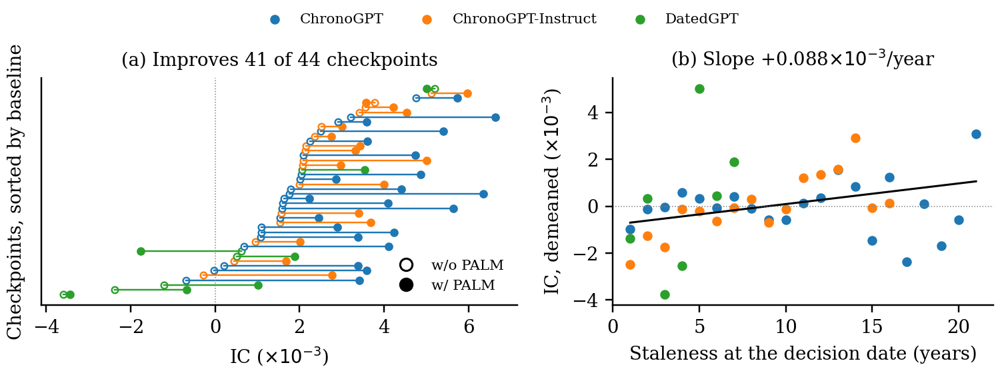

<h1 align="center">PALM: Point-in-Time Adaptation for Financial Language Models</h1>

<p align="center">
  <a href="https://arxiv.org/abs/2609.30316"></a>
  <a href="https://icaif2026.org/"></a>
  <a href="https://huggingface.co/datasets/Zihan1004/FNSPID"></a>
</p>

Point-in-time language models are pretrained only on text published before a documented cutoff, one checkpoint per year, so that a backtest never uses a model that has seen its own future. Every added year costs another pretraining run. **PALM** asks whether that run is necessary, and answers with a rank-1 to rank-16 adapter fitted on financial text the checkpoint is allowed to read, with every pretrained weight frozen.

<p align="center">
  
</p>

**What the paper finds**, on 44 vintages of ChronoGPT, ChronoGPT-Instruct and DatedGPT scored on one fixed evaluation window (next session, open to close):

* **A newer checkpoint is not detectably better.** The IC of the released checkpoints shows no decay with age: slope +0.088 × 10⁻³ per year, 90% interval [−0.140, +0.321].
* **A small adapter does the work of the run.** PALM raises the pooled IC from 1.63 to 3.40 × 10⁻³ (+1.77, 95% interval [−0.15, +3.71]) and improves 41 of the 44 checkpoints.
* **The gain is domain, not recency.** Text from *before* the cutoff gains as much as the text the vintage is missing, so the point-in-time constraint comes without a detectable cost.

An adapted checkpoint reads nothing from the evaluation window, so it stays eligible wherever the original one was.

## Quick start

```bash
pip install -r requirements.txt
```

Download two files from [FNSPID](https://huggingface.co/datasets/Zihan1004/FNSPID) (CC BY-NC 4.0) into `data/`: `Stock_news/nasdaq_exteral_data.csv` (23 GB) and `Stock_price/full_history.zip`. Then:

```bash
bash run/verify.sh             # a one-minute check that the tree is wired
bash run/00_data.sh            # rebuild the paper's panel and its targets
bash run/01_score_base.sh      # score the 44 checkpoints as released      (GPU)
bash run/02_adapt.sh           # fit PALM and score again                  (GPU)
bash run/03_metrics.sh         # the daily series behind every number
bash run/04_tables_figures.sh  # tables, macros and the figure above
```

Steps 1 and 2 need a CUDA GPU and about 30 GPU-hours on an L40S for the headline table; they skip outputs already on disk, so they can be interrupted and resumed. Everything else runs on a laptop. Set `PALM_ROOT` to keep data and results away from the code.

**The panel.** The paper scores 252,000 article-days, 25,200 per year from 2014 to 2023, over 1,099 tickers. FNSPID has no article identifier, so `data/panel_ids.parquet` ships with the repository and names every row by its timestamp, ticker and text hash, with the trading day, publisher and return already attached. `run/00_data.sh` restores the exact panel from the FNSPID file and refuses to write if any row is missing. The text itself is not redistributed.

**The setting.** The adapter setting was chosen once per backbone on a validation window that ends where the test window begins (`configs/settings.txt`):

| Backbone | Rank | Steps | Learning rate |
| --- | :-: | :-: | :-: |
| ChronoGPT | 4 | 1,200 | 10⁻⁴ |
| ChronoGPT-Instruct | 1 | 600 | 10⁻⁴ |
| DatedGPT | 16 | 300 | 10⁻⁴ |

`bash run/02_adapt.sh val` reruns the validation grid and `palm/select_config.py` the rule that picked these.

**The other arms.** Every control, bound and alternative in the paper is one line of `configs/arms.txt` and one command, for example `ARM=dom_ps bash run/02_adapt.sh` for the same-domain control or `ARM=full_ft bash run/02_adapt.sh` for full finetuning. Tables whose arms are absent are left out rather than failing.

**Keeping the adapters.** The pipeline scores each adapter in the process that trains it and keeps only the scores. `SAVE_ADAPTERS=1 bash run/02_adapt.sh` also writes each adapter to `results/adapters/`, and `palm/adapt.py --load-adapter` scores with it later. Training is seeded and scoring is a single forward pass, so a saved adapter reproduces the scores of the run that produced it.

## How the evaluation avoids look-ahead

* **An article belongs to the day it could have been read.** It is credited to a trading day only if stamped before that day's close (20:00 UTC), and the primary target is the next session's open-to-close return, tradable at the next open.
* **A checkpoint is eligible only if its cutoff precedes the decision date.** Vintages cut at the end of 2020 or later are scored but never reported.
* **The adapter reads only what the checkpoint was already allowed to read.** No return label enters the objective, and `palm/audit.py` checks every scored arm on disk for an adapter that read past its date.

## Layout

```
palm/      restore_panel, shift_returns   FNSPID -> the panel and its targets
           adapt                          fit the adapter on eligible text, then score
           daily, stats, report, main_figure   daily series -> intervals -> tables and figure
           select_config, audit           the validation rule; the point-in-time audit
configs/   checkpoints.txt  settings.txt  arms.txt
data/      panel_ids.parquet              the 252,000 article-days the paper scores
run/       the six steps above
```

## Citation

```bibtex
@inproceedings{lee2026palm,
  title     = {{PALM}: Point-in-Time Adaptation for Financial Language Models},
  author    = {Lee, Seunghan and Seo, Jun and Lee, Jaehoon and Kang, Junhyeok and
               Han, Sangjun and Yoo, Sungdong and Kim, Minjae and Lim, Tae Yoon and
               Kang, Dongwan and Choi, Hwanil and Lee, Soonyoung and Ahn, Wonbin},
  booktitle = {ICAIF '26 Workshop on LLMs and Generative AI for Finance (AI4F)},
  year      = {2026},
  note      = {arXiv:2609.30316}
}
```
